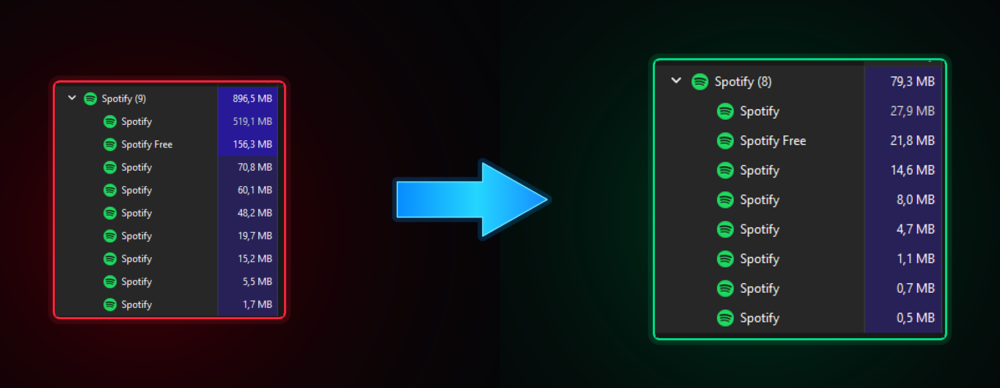

# Memory Sentry

Memory Sentry is an open-source utility for managing the resident working set of Spotify Desktop processes while Spotify runs in the background.

**Current release:** `1.0.0-rc.2` — experimental release candidate, not a stable release.

The current release requires Spotify Desktop and Spicetify CLI for the same Windows user. The Spicetify Custom App communicates with the Memory Sentry server, which runs as a **separate per-user process**, is currently implemented in Rust, and performs the Windows memory operations. Memory Sentry is an independent community project, not an official Spotify or Spicetify product.

## Features

- Automatic and manual working-set limits for Spotify processes in the background.
- Role-based limits with persistent manual role overrides.
- A master power switch that stops new limits and requests restoration of recorded Windows limits.
- Local-only dashboard and diagnostics; the server does not upload telemetry.

## Policy and controls

Memory Sentry limits the **resident working set**—the amount of process memory currently resident in physical RAM. It does not decommit memory or directly reduce committed memory, and the observed reduction varies by PC and workload.

In automatic mode, a ceiling can increase by 8 MB only when CPU usage is at least 10% of one logical processor for **six consecutive seconds** while the process uses its **full current working-set ceiling**. A ceiling can decrease by 4 MB after CPU remains at or below 3% and the process has at least 6 MB of working-set headroom for **ten seconds**. Adjustments have an eight-second cooldown and role-specific limits. Main's automatic ceiling is capped at 36 MB; Audio uses a fixed 36 MB ceiling and is not adaptively adjusted.

In manual mode, role defaults are Main/Audio 36 MB, GPU/Renderer 28 MB, Utility/Helper 24 MB, and Crashpad 16 MB. A manual limit below the process role's default requires a **five-second warning countdown** and explicit confirmation.

The **same configured background delay applies in both modes**. The **dashboard power switch is the master on/off control**: disabling Memory Sentry stops new limits and requests restoration of original limits. If restoration cannot be confirmed immediately, pending recovery data is retained for retry.

## Requirements

- Windows 10 or Windows 11 desktop edition, x64.
- [Spotify Desktop](https://open.spotify.com/download) and [Spicetify CLI](https://spicetify.app/) installed for the same Windows user.

Windows Server, Windows ARM64, macOS, and Linux are not supported by this release.

## Installation

Download **Memory Sentry Setup** and the matching SHA-256 checksum from the [official GitHub Releases page](https://github.com/yanlvl99/memory-sentry/releases), verify the checksum, and follow the [Installation Guide](docs/INSTALLATION.md). The official per-user Setup EXE is the only supported installation method. The Marketplace entry only links to the project repository; it does not install or distribute the server.

No unsigned release can guarantee zero SmartScreen warnings. This release is unsigned, and a checksum verifies file integrity—not publisher identity. Do not disable security tools or blindly bypass warnings.

## Testing and project status

CI validates package metadata and JavaScript syntax, runs platform-independent Rust policy tests on Linux and Windows, and builds the Windows x64 server and setup package. These checks do not constitute an end-to-end test of Spotify playback, foreground restoration, or compatibility across desktop systems.

The broader Windows 10/11 desktop test matrix remains incomplete. Results may vary by hardware, Spotify workload, and Windows configuration, so the project remains experimental.

## Development

Install Node.js 22+ and a stable Rust toolchain to run package checks and policy tests:

    node tests/validate-package.js
    cargo test --manifest-path server/Cargo.toml --locked

For Windows server builds and packaging, see the [Development Guide](docs/DEVELOPMENT.md). For repeatable performance measurements, see [Benchmarking](docs/BENCHMARKING.md).

## Security and privacy

The server API binds to `127.0.0.1` and requires an internal per-install token. Settings, recovery data, and diagnostic logs are stored locally. Upgrade and uninstall procedures include recovery checks and may stop rather than remove files when restoration cannot be confirmed.

See [SECURITY.md](SECURITY.md) and [PRIVACY.md](PRIVACY.md) for details and limitations.

## Documentation

- [Installation Guide](docs/INSTALLATION.md)
- [Troubleshooting](docs/TROUBLESHOOTING.md)
- [Development Guide](docs/DEVELOPMENT.md)
- [Release checklist](docs/RELEASE_CHECKLIST.md)
- [Server migration and release gate](docs/SERVER-MIGRATION.md)
- [Changelog](CHANGELOG.md)

## License

Memory Sentry is licensed under [GPL-3.0](LICENSE).
