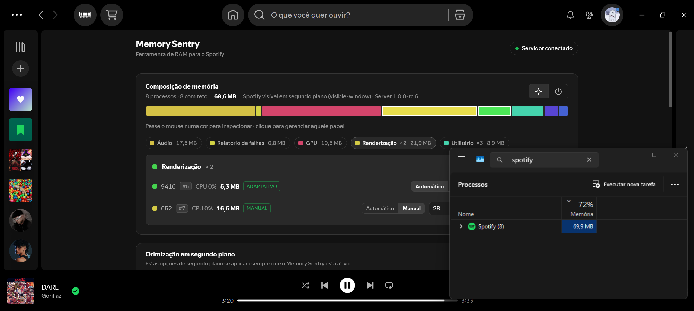

# Memory Sentry

[](https://github.com/yanlvl99/memory-sentry/releases)
[](https://github.com/yanlvl99/memory-sentry/actions/workflows/validate.yml)
[](LICENSE)


Memory Sentry is designed to reduce Spotify Desktop's resident RAM usage while it runs in the background. It does this by applying adaptive working-set limits to individual Spotify processes.

The trade-off: Spotify may take longer to become responsive when you bring it back to the foreground.

The dashboard is integrated into Spotify through Spicetify. A separate, per-user Rust process handles the Windows memory operations. Memory Sentry is an independent community project, not an official Spotify or Spicetify product.



*Dashboard snapshot from one session. This is not a controlled before-and-after benchmark.*

> **Experimental:** The current release is a release candidate, not a stable release. The full Windows desktop test matrix is still incomplete. Results and restore times vary by hardware, workload, and Windows configuration.

## What it does

- **Per-process limits:** Monitors Spotify's process tree instead of treating the application as one process.
- **Adaptive control:** Adjusts working-set ceilings using each process's recent memory demand and system memory pressure.
- **Background triggers:** Choose whether optimization runs when Spotify is behind another window, minimized, hidden, or in any combination of those states.
- **Manual limits:** Pin an individual process to a fixed ceiling while other processes continue using the adaptive policy.
- **Persistent identities:** Manual and learned settings follow a process identity derived from its role and selected command-line attributes, not its Windows PID.
- **Recovery:** Requests restoration of the original Windows limits when Spotify returns to the foreground or optimization is disabled.

## Requirements

- Windows 10 or Windows 11 desktop edition.
- x64 or ARM64 processor architecture.
- Spotify Desktop and [Spicetify CLI](https://spicetify.app/) installed for the same Windows user.

Windows Server, macOS, and Linux are not supported.

## Installation

1. Open the [GitHub Releases page](https://github.com/yanlvl99/memory-sentry/releases).
2. Download the **Memory Sentry** MSI matching your system architecture (`x64` or `arm64`), together with its `.sha256` checksum.
3. Verify the checksum before running the installer.
4. Run the MSI as the same Windows user that runs Spotify and Spicetify. **Do not run it as Administrator.**
5. Once setup finishes and Spotify reloads, open **Memory Sentry** from Spotify's sidebar.

See the [Installation Guide](docs/INSTALLATION.md) for detailed installation, upgrade, and uninstall instructions.

**About the Marketplace:** The Spicetify Marketplace entry only links to this repository. It does not install or distribute the Memory Sentry server. The official per-user MSI is the only supported installation method.

**Release warning:** Current installers are unsigned and may display Windows SmartScreen reputation warnings. A SHA-256 checksum confirms file integrity, not publisher identity. Do not disable Windows security tools or blindly bypass warnings.

## Using Memory Sentry

Open Memory Sentry from Spotify's sidebar.

The main memory mode has two states:

- **Custom:** Runs the adaptive policy and allows individual processes to be pinned to manual limits.
- **Disabled:** Stops applying new limits and requests restoration of the original Windows limits.

Under **Optimize when**, select the Spotify window states that should trigger optimization and choose the background delay.

A manual limit only overrides the adaptive policy for the selected process. The remaining Spotify processes continue to be managed independently.

## How it manages memory

Spotify runs multiple processes for different tasks, such as audio, rendering, GPU work, and utility services. Memory Sentry discovers this process tree and classifies its members by role.

The adaptive policy maintains a history of each process's working-set demand. It uses that history alongside Windows memory-pressure information to choose a suitable ceiling. CPU and page-fault signals help detect when a process may need additional headroom.

On Windows, Memory Sentry applies per-process working-set limits through [`SetProcessWorkingSetSizeEx`](https://learn.microsoft.com/en-us/windows/win32/api/memoryapi/nf-memoryapi-setprocessworkingsetsizeex).

### What working set means

A process's **working set** is the portion of its memory currently resident in physical RAM.

Changing a working-set limit does not decommit process memory or directly reduce its commit size. Pages may need to become resident again when Spotify resumes, which can increase page faults and delay interaction.

Memory Sentry only manages Spotify's process tree. It is not a system-wide RAM cleaner, and it does not promise a fixed amount or percentage of memory savings.

For a repeatable way to measure memory changes and restore responsiveness, see the [Benchmarking Guide](docs/BENCHMARKING.md).

### Recovery behavior

Before applying a limit, the server records the original Windows limits for the affected process. It attempts to restore them when Spotify returns to the foreground, when optimization is disabled, and during shutdown or recovery on the next launch.

If restoration cannot be confirmed, recovery data is retained for another attempt. Do not delete recovery files manually.

## Privacy and security

Memory Sentry is designed to run locally.

- No telemetry, analytics SDK, crash-reporting service, or remote logging.
- The server API binds to `127.0.0.1` and requires an internal per-install token.
- Settings, learned usage profiles, recovery data, and diagnostic logs stay on the PC.
- Process metadata is read to discover and monitor Spotify's process tree. Spotify account credentials, track names, playlists, and listening history are not intentionally read or stored.
- The installer runs per-user and does not require administrator privileges.

See [PRIVACY.md](PRIVACY.md) and [SECURITY.md](SECURITY.md) for more details.

## Development

The project uses Rust for the Windows server and JavaScript for the Spicetify Custom App.

Requirements:
- Stable Rust toolchain.
- Node.js 22 or newer for package validation.

Run the main checks from the repository root:

```bash
node tests/validate-package.js
cargo test --manifest-path server/Cargo.toml --locked
```

CI also builds the Windows x64 and ARM64 packages. Automated checks do not replace testing the full application with Spotify on real Windows desktop systems.

See the [Development Guide](docs/DEVELOPMENT.md) for build, packaging, and testing details.

## Documentation

- [Installation Guide](docs/INSTALLATION.md)
- [Troubleshooting](docs/TROUBLESHOOTING.md)
- [Benchmarking Guide](docs/BENCHMARKING.md)
- [Development Guide](docs/DEVELOPMENT.md)
- [Privacy Policy](PRIVACY.md)
- [Security Policy](SECURITY.md)
- [Changelog](CHANGELOG.md)

## License

Memory Sentry is licensed under [GPL-3.0](LICENSE).